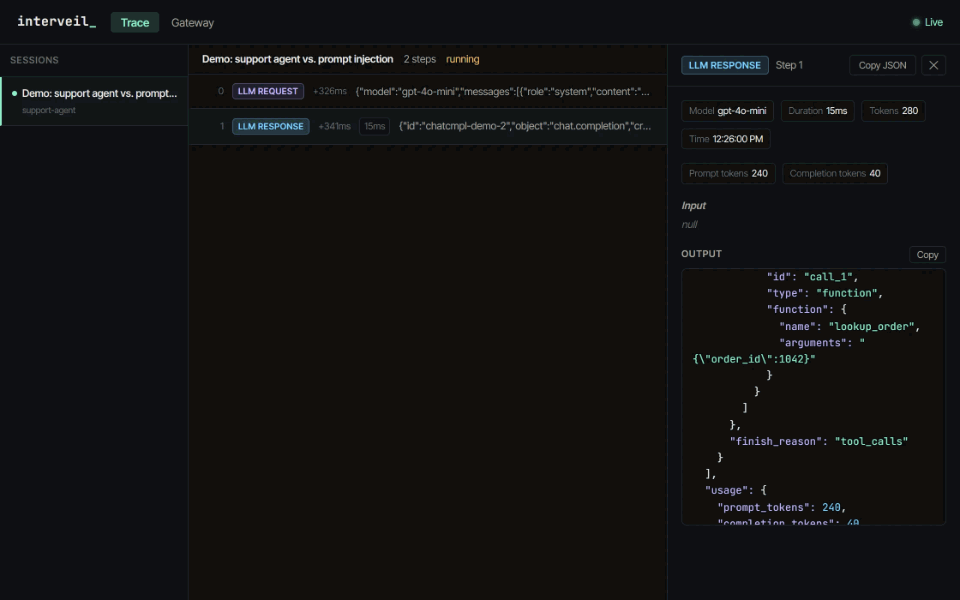
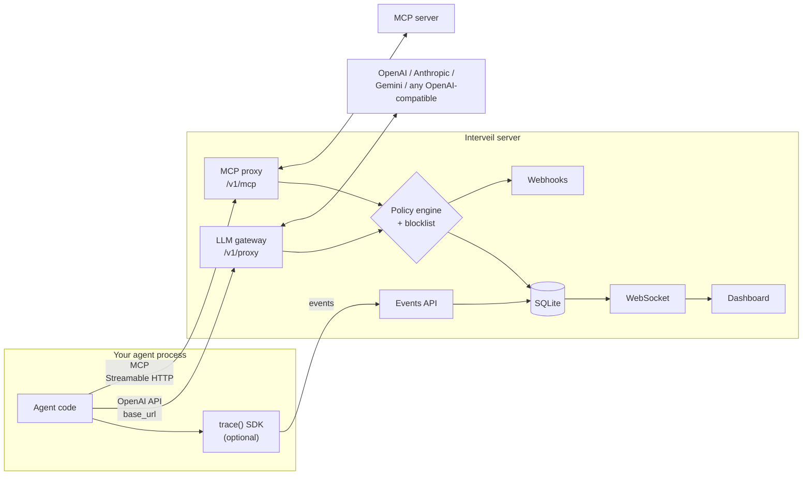

# Interveil

[](https://github.com/rpuranikx/Interveil/actions/workflows/ci.yml)

**A self-hosted gateway that traces AI agent runs and blocks disallowed tool calls before the agent can execute them, with policies in YAML.**



Point an agent's OpenAI `base_url` (or its MCP client) at Interveil. Every model call and tool call shows up live in a dashboard. Each tool call the model proposes is checked against your policy and a destructive-command blocklist, and disallowed calls are withheld before the agent ever receives them. Violations are recorded and can page you through a webhook.

> **Status: v0.1.** Install from source; not yet on npm or PyPI. Read [Limitations](#limitations) before relying on it.

## Quick start

Requires Node.js 22.12+ and pnpm (`corepack enable` installs the pinned version).

```bash
git clone https://github.com/rpuranikx/Interveil.git && cd Interveil
pnpm install
pnpm demo
```

`pnpm demo` needs no API keys. It opens the dashboard and runs a support agent that reaches a scripted model only through the gateway:

1. The agent looks up order #1042 and refunds $49. Both are allowed; the refund is recorded as `POLICY_AUDIT`.
2. The order notes contain a prompt injection. The model proposes a $4,900 refund to another account and a `curl … | bash`.
3. The gateway withholds both tool calls (one by the [YAML policy](interveil/examples/policies/support-agent.yaml), one by the blocklist), tells the agent why, and posts a webhook alert for each.

To run the server for your own agents: `pnpm build && node interveil/dist/cli.js serve`, or `docker compose up` (published on `127.0.0.1:3000`, data in the `interveil-data` volume, settings from `interveil/.env`; see [`.env.example`](interveil/.env.example)).

## How it works



Enforcement happens at four points, all driven by the same policy file and blocklist:

| Where | What is checked | Effect of a violation | Integration |
|---|---|---|---|
| **LLM gateway** | Every tool call in a model response, streaming or not | Tool calls withheld; the agent gets an explanation with `finish_reason: "stop"` | Change `base_url` |
| **MCP proxy** | Every `tools/call` request | Never forwarded; the client gets an `isError` tool result | Change the MCP server URL |
| **`trace()` SDK** | Every method call on the wrapped object | `PolicyViolationError` thrown before the method runs | Wrap the agent object |
| **Policy API** | Any tool call an agent runs itself, via `POST /api/v1/policy/evaluate` | The caller denies it (e.g. a Claude Agent SDK or Claude Code `PreToolUse` hook) | Register a hook |

## Integrations

| Stack | How | Lines changed | Example |
|---|---|---|---|
| Any OpenAI-compatible client (Python, TS, IDE tools) | `base_url="http://localhost:3000/v1/proxy"` | 1 | below |
| Anthropic SDK clients, Codex (Responses API) | Base URL → the gateway's [native routes](#native-anthropic-and-responses-routes) | 1 | below |
| OpenAI Agents SDK (Python) | Default client pointed at the gateway, Chat Completions API | 3 | [`examples/openai-agents`](interveil/examples/openai-agents) |
| MCP clients (official SDK, Streamable HTTP) | Server URL → `http://localhost:3000/v1/mcp` | 1 | [`examples/mcp`](interveil/examples/mcp) |
| Claude Code | `interveil init claude-code` writes the `PreToolUse` hook | 0 | [below](#coding-agents-claude-code) |
| Claude Agent SDK | `PreToolUse` hook that calls the policy API | 3 | [`examples/claude-agent-sdk`](interveil/examples/claude-agent-sdk) |
| TypeScript agent objects | `trace(agent, { policyFile })` | 1–2 | [`examples/typescript`](interveil/examples/typescript) |
| Python agent objects | `trace(agent, agent_id=..., enforce_policy=True)` | 1–2 | [`examples/python`](interveil/examples/python) |
| Anything else | POST events to the HTTP API | — | [API](#api) |

The OpenAI Agents SDK and MCP examples are verified against the real SDKs (`openai-agents` 0.24, `@modelcontextprotocol/sdk` 1.32); the MCP one is also an automated test. The Claude hook's decisions are verified against a running server and its imports against `claude-agent-sdk` 0.2.173. `InterveillCallbackHandler` (LangChain.js) and `createTracedAnthropic` (Anthropic SDK) are exported for tracing only; they do not enforce.

```python
from openai import OpenAI

client = OpenAI(
    base_url="http://localhost:3000/v1/proxy",
    api_key="sk-...",                                    # forwarded to the provider, never stored
    default_headers={"x-interveil-agent-id": "support-agent"},  # which policy rules apply
)
```

## Coding agents (Claude Code)

```bash
pnpm build                                          # in your Interveil clone
cd ~/your-project && node ~/Interveil/interveil/dist/cli.js init claude-code
node ~/Interveil/interveil/dist/cli.js serve --preset coding-agent
```

`init` copies the hook to `~/.interveil/hooks/claude-code.js`, adds it to `.claude/settings.json` (`--user` for `~/.claude/settings.json`), and creates an API key in `~/.interveil/api-key`. The hook and the server read the key from that file, not from the environment, so the agent's shell never sees it. The hook entry runs Node directly (no shell) with `"onFailure": "block"`, so if the hook can't start, crashes or times out, the tool call is blocked rather than allowed. That needs Claude Code 2.1.295 or later; older versions let a failed hook through, and `init` checks `claude --version` and warns. Self-protection refuses tool calls that touch `~/.interveil` or the settings files, so the agent can't move, edit or unregister the hook.

What happens to each tool call:

| Layer | Examples | Decision |
|---|---|---|
| Self-protection (built in) | `curl localhost:3000/api/v1/policy/halts/…` (or `127.1:3000`, `0x7f000001:3000`, `/dev/tcp/…/3000`), `pkill -f '[i]nterveil'`, editing the loaded policy file or `.claude/settings*.json` (including through globs such as `.cl*/sett*`), reading `~/.interveil/`, `echo $INTERVEIL_API_KEY` | deny |
| Blocklist (built in) | `rm -rf ~`, `rm -rf ..`, `curl … \| sh`, `find -exec rm`, `cat ~/.ssh/id_rsa`, `psql -c "drop table …"` | deny |
| [`coding-agent` preset](interveil/examples/policies/coding-agent.yaml) | `printenv \| curl`, writing `.env*`, `base64 -d > x.sh`, `aws s3 rb`, `kubectl delete`, `psql -c "delete from …"` | deny |
| | `git reset --hard`, `git push --force`, `git clean -f`, reading `.env`, a `curl` that sends `$…TOKEN`, `WebFetch` | Claude Code asks you |
| Secret literals (preset) | A network command or `WebFetch` URL carrying something shaped like an API or private key (`sk-…`, `sk_live_…`, `ghp_…`, `AKIA…`, a JWT, `-----BEGIN … PRIVATE KEY`) | deny |
| | A network command carrying a base64 blob, piping through `base64`, or a `password=`/`token=` value | Claude Code asks you |
| Session flow (preset) | A network command (`curl`, `nslookup`, `gh`, `aws`, `git push`, `python -c`, `/dev/tcp`, …) or `WebFetch` after the session read `.env` (also through `cat .e*` or `Grep`), a key file, `printenv`, or ran a recursive search for secret-looking words (`grep -r KEY .`, `git grep -i token`) | Claude Code asks you |
| | A network command after the session read a secret *and* pulled in web content (`WebFetch`, `WebSearch`) | deny |
| | Everything else, including `rm -rf node_modules`, `git rm -r`, a SQL migration in `Write`, a README with `curl … \| bash` in `Edit` | allow (Bash is recorded as `POLICY_AUDIT`) |

The blocklist reads Bash commands and file paths, not the bodies of `Write` and `Edit` or other prose fields, so writing code that mentions a dangerous command is fine. If the server is down, every tool call is denied, and the denial says how to start it. [`coding-agent-preset.test.ts`](interveil/src/policy/coding-agent-preset.test.ts) runs each of these calls through the same decision path the hook uses.

**Why not just Claude Code permissions?** Permissions and a sandbox are the right first line, and Interveil doesn't replace them. It adds three things. One YAML policy applies across Claude Code, the Agent SDK, OpenAI-compatible agents and MCP clients, rather than separate settings in each agent. Rules look inside arguments, so `git push --force` and `git push` are different calls, and across calls, so `curl` after reading `.env` is not the same as `curl` in a fresh session. And every denial and audited call lands in one trace store with a dashboard and webhook alerts, so you can see what a prompt-injected agent tried to do.

---

## Policy as code

```yaml
version: "1.0"
defaultAction: allow            # or `block` for deny-by-default

agents:
  - id: billing-agent
    rules:
      - id: large-refunds
        action: block
        message: Refunds over $100 need a human
        condition:
          tool: refund
          args.0.amount: { greaterThan: 100 }   # first argument's `amount` field
      - id: audit-refunds
        action: allow_and_audit
        condition: { tool: refund }

  - id: "*"                     # applies to every agent, after its own rules
    rules:
      - id: no-drops
        action: halt_agent
        severity: critical
        condition: { tool: dropDatabase }

alerts:
  webhooks:
    - url: https://hooks.example.com/interveil
      secretEnv: INTERVEIL_WEBHOOK_SECRET   # optional: env var holding the HMAC secret
```

Load it with `interveil serve --policy-file policy.yaml` (or a bundled one: `--preset coding-agent`) (gateway and MCP proxy) or `trace(agent, { policyFile })`.

- **Actions:**
  - `allow`.
  - `allow_and_audit`: runs, and records `POLICY_AUDIT`.
  - `block`: refused, and records `POLICY_VIOLATION`.
  - `require_approval`: the Claude Code hook asks the user through Claude Code's own permission prompt; everywhere else, refused.
  - `halt_agent`: refused, and every later request from that agent is refused too. Server-side halts (gateway, MCP proxy, policy API) are saved in the store, survive restarts, and stay until lifted with `DELETE /api/v1/policy/halts/<agent_id>`; `trace()` halts last for the wrapped object's lifetime.
- **Conditions:** `tool` matches the tool or method name (or any name in a list). Any other key is a dot path into `{ args: [arguments] }` (the same shape in the gateway, MCP proxy and SDK), matched by an exact value or by constraints: `equals`, `notEquals`, `greaterThan`, `lessThan`, `contains`, `matches` (a regular expression, or a list that must all match), `mentionsPath` (the path or shell command names one of these files, including through a glob, brace expansion or parent directory: `cat .e*` mentions `.env`) and `oneOf`; `ignoreCase: true` makes `contains` and `matches` case-insensitive. All keys and constraints must match; a value of the wrong type never matches. Example: `{ tool: [Write, Edit], args.0.file_path: { matches: '(^|[/\\])\.env$' } }`.
- **Order:** the agent's own rules, then `*` rules, then `defaultAction`. First match wins.
- **Session flow:** `tag: secret-read` on a rule marks the session when that rule matches a call that may run (`allow`, `allow_and_audit`, `require_approval`; a blocked call tags nothing). A later rule with `condition: { session: { tagged: [secret-read, untrusted-content] } }` matches only once every listed tag is set in the same session. Sessions come from `session_id` (policy API and hooks), `x-interveil-session-id` (gateway), or the MCP session; calls without one share a per-agent scope. A `session.tagged` that no rule sets is a load error. Tags live in server memory, so a restart clears them.

  ```yaml
  - id: no-send-after-export
    action: block
    condition: { tool: send_email, session: { tagged: customer-export } }
  - id: export
    action: allow_and_audit
    tag: customer-export
    condition: { tool: export_customers }
  ```
- **Fails closed:** a missing file, invalid YAML, an unknown action or a misspelled key throws `PolicyLoadError`. `serve` exits; `trace()` refuses to wrap the agent.
- **Environments:** `environments.<staging|production>.haltOnCritical: true` escalates `block` rules with `severity: critical` to `halt_agent`.

### Webhook alerts

The server posts `{"type": "policy.violation", "agent_id", "tool", "rule_id", "source", "message", "halt", "enforced_at", "session_id", "timestamp"}` for every violation it records, from the gateway, the MCP proxy or an SDK. Add `events: [POLICY_VIOLATION, POLICY_AUDIT]` to a hook to receive audits too. Delivery runs in the background (5 s timeout, one retry). With a secret set, verify the signature:

```typescript
const expected = 'sha256=' + createHmac('sha256', secret).update(`${req.headers['x-interveil-timestamp']}.${rawBody}`).digest('hex');
const valid = timingSafeEqual(Buffer.from(expected), Buffer.from(req.headers['x-interveil-signature']));
```

### Command blocklist

Applied everywhere a policy is, with no configuration. Every argument (nested objects, arrays and keys included) is lowercased, stripped of quotes and backslashes, whitespace-collapsed and split on `;`, `&&`, `||`, `$(` and backticks. For coding-agent tools (`Bash`, `Write`, `Edit`, `Grep`, …) file bodies, search patterns and descriptions are skipped, and SQL rules only fire on a Bash command that runs a database client. Each piece is checked against named rules:
- recursive `rm` whose target leaves or wipes the working tree (`/`, `~`, `$VAR`, `..`, `.`, `*`), `sudo rm`, `find -delete`, `find -exec rm`, `xargs rm`, `shutil.rmtree`
- `curl|wget … | sh`, `base64 -d … | sh`
- `DROP TABLE/DATABASE`, `TRUNCATE`
- `mkfs`, `dd of=/dev/…`, `format c:`, `chmod 777 /…`
- `/etc/passwd|shadow|sudoers`, SSH private keys (`id_rsa`, `id_ed25519`, …), `~/.aws/credentials`

The TypeScript and Python implementations share a [test corpus](interveil/test-fixtures/blocklist-cases.json) of 48 inputs that must be blocked and 22 that must not. This is a speed bump for obviously destructive commands, not a sandbox: a determined agent can obfuscate a command past any pattern list.

---

## LLM gateway

`POST /v1/proxy/chat/completions` (OpenAI Chat Completions format, translated to other providers), plus the [native routes](#native-anthropic-and-responses-routes) `/v1/proxy/messages` (Anthropic) and `/v1/proxy/responses` (OpenAI Responses). Requests and responses are recorded as `LLM_REQUEST` / `LLM_RESPONSE`, with tokens and latency.

**Sessions and agents:** `x-interveil-session-id` groups requests into a session; without it, requests are grouped into one session per day. `x-interveil-agent-id` selects the policy rules (default `default`).

**Tool-call enforcement:**
- If any tool call in a response is disallowed, all of that response's tool calls are withheld. The client gets `finish_reason: "stop"` and a message naming each rule.
- When streaming, text deltas still arrive live; tool-call chunks are held until the stream ends, then released byte-for-byte or replaced.
- `LLM_RESPONSE` keeps what the model originally proposed, next to the `POLICY_VIOLATION` events.

**Provider keys:** a client's own `Authorization: Bearer <provider key>` is forwarded and never stored. If the client sends no key, or sends the Interveil API key, the server uses `OPENAI_API_KEY` / `ANTHROPIC_API_KEY` / `GEMINI_API_KEY`.

**Other APIs:** `OPENAI_BASE_URL` points the gateway at any OpenAI-compatible API (Azure OpenAI, OpenRouter, Ollama).

| Provider (by model prefix) | Non-streaming | Streaming |
|---|---|---|
| OpenAI (`gpt-`, `o1`, `o3`, `o4-mini`, `codex-`, …) and any other model id, via `OPENAI_BASE_URL` | Passed through | Passed through |
| Anthropic (`claude-`) | Translated to/from the Messages API | Anthropic events translated to OpenAI chunks |
| Gemini (`gemini-`) | Translated to/from `generateContent` | Gemini SSE translated to OpenAI chunks |

Tool calls are enforced for every provider, streaming or not. Translation covers system prompts, tools and `tool_choice`, assistant tool calls, tool results (merged into one message where the provider requires it), image inputs (Anthropic), `stop`, `top_p`, and token usage. The Gemini key is sent in the `x-goog-api-key` header, never in the URL.

### Native Anthropic and Responses routes

These routes are not translated: requests and responses keep the provider's own format, so clients built on those APIs work unchanged.

| Route | Upstream | Tool calls gated | For |
|---|---|---|---|
| `POST /v1/proxy/messages` (also `/v1/proxy/v1/messages`) | `ANTHROPIC_BASE_URL` or api.anthropic.com | `tool_use` blocks | Anthropic SDKs, Claude Code |
| `POST /v1/proxy/v1/messages/count_tokens` | same | (forwarded as-is, not traced) | Claude Code |
| `POST /v1/proxy/responses` | `OPENAI_BASE_URL` or api.openai.com | `function_call`, `custom_tool_call`, `local_shell_call`, `shell_call`, `apply_patch_call`, `computer_call` items | OpenAI SDKs, Codex |

If any tool call in a response is disallowed, everything from the first tool call on is replaced by a text block (Messages) or message item (Responses) naming each rule. The turn ends normally (`stop_reason: "end_turn"`), so the client has nothing to execute. When streaming, events before the first tool call arrive live, and the rest are held until the stream ends, then released byte-for-byte or replaced. The client's own key is forwarded (`x-api-key` or a bearer token for Anthropic, a bearer for OpenAI), along with `anthropic-version`, `anthropic-beta` and the query string. Without one, the server uses `ANTHROPIC_API_KEY` / `OPENAI_API_KEY`.

```bash
# Claude Code (the hook is still the recommended setup; see Coding agents)
ANTHROPIC_BASE_URL=http://127.0.0.1:3000/v1/proxy \
ANTHROPIC_CUSTOM_HEADERS="x-interveil-agent-id: claude-code" claude
```

```toml
# Codex: ~/.codex/config.toml
model_provider = "interveil"
[model_providers.interveil]
name = "Interveil"
base_url = "http://127.0.0.1:3000/v1/proxy"
env_key = "OPENAI_API_KEY"
wire_api = "responses"
http_headers = { "x-interveil-agent-id" = "codex" }
```

With a server API key set, the client must also send it (`x-interveil-key`), which puts it in the agent's environment. The hook keeps it in a file instead. Both routes are tested against fake providers that send each API's documented event sequence. They have not yet been run end to end with Claude Code or Codex.

## MCP proxy

`interveil serve --mcp-server http://localhost:8080/mcp` forwards `/v1/mcp` to one MCP server over Streamable HTTP:
- **Transport:** `Accept`, `Mcp-Session-Id` and `MCP-Protocol-Version` are forwarded, and SSE responses are passed through. The optional server-to-client `GET` stream returns 405.
- **Recording:** `tools/call` requests and results are recorded as `TOOL_CALL` / `TOOL_RESULT`.
- **Enforcement:** each call is checked before it is forwarded.

Stdio servers are not supported.

## SDKs

**TypeScript:** `npm install /path/to/Interveil/interveil` after `pnpm build`.

```typescript
import { trace } from 'interveil';

const agent = trace(new MyAgent(), { agentId: 'billing-agent', policyFile: './policy.yaml' });
await agent.refund({ amount: 500 });   // throws PolicyViolationError; refund() never runs
```

| Option | Default | Meaning |
|---|---|---|
| `host`, `port` | `localhost`, `3000` | Interveil server |
| `sessionName` | timestamp | Label in the dashboard |
| `agentId` | `'default'` | Agent id used by policy rules |
| `policyFile` | — | YAML policy; invalid files throw `PolicyLoadError` |
| `commandConfig` | — | `{ block, whitelist, requireApproval }` extra patterns |
| `dryRun` | `false` | Record calls without executing them |
| `autoOpen` | `true` | Open the dashboard on the first call |

**Python:** no dependencies; copy `interveil/python/interveil` into your project. `trace(agent, blocked_patterns=[...])` applies the blocklist locally. `trace(agent, agent_id="billing-agent", enforce_policy=True)` also asks the server's policy before each call (positional arguments, plus kwargs as a final dict, are evaluated as `args`) and raises `PolicyViolationError`; if the server can't answer, the call is refused.

**Policy API:** `POST /api/v1/policy/evaluate` with `{"tool", "agent_id", "arguments"}` (a tool-call arguments object) or `{"tool", "agent_id", "args"}` (positional arguments) returns `{"allowed", "audit", "halt", "approval_required", "rule_id", "source", "message", "tags"}`. Add `session_id` to record the decision in that session and to scope session tags to it.

---

## Security model

**Protected:**
- The server binds to `127.0.0.1`. To expose it, set `INTERVEIL_API_KEY` and use `--host 0.0.0.0`.
- With a key set, `/api` (except health), `/v1` and `/ws` require it (`x-interveil-key` or `Authorization: Bearer`). The SDKs read the same variable; the dashboard asks for it.
- Requests and WebSocket handshakes from other browser origins are refused unless listed in `--allowed-origins`, so a web page cannot read your traces or spend your provider keys.
- Without an API key, only loopback `Host` names are served: `localhost`, `*.localhost`, and IP literals in `127.0.0.0/8` or `::1` (parsed, so a DNS name such as `127.evil.example` doesn't count), plus any in `INTERVEIL_ALLOWED_HOSTS`. This stops DNS rebinding, where a web page re-points its own domain at 127.0.0.1 so the origin check passes. With a key set, any host is served, since the page can't authenticate.
- Per-IP rate limits: 1000/min on `/api` and 120/min on `/v1`, configurable with `INTERVEIL_RATE_LIMIT_*`.
- `interveil init` writes a key to `~/.interveil/api-key`; `serve` uses it when `INTERVEIL_API_KEY` is unset.
- Self-protection: tool calls that reach for the server's port, its key or data directory, the loaded policy file, `.claude/settings*.json`, or the server process are denied for every agent, before the policy runs.

**Not protected:** see the first three [Limitations](#limitations).

## Performance

`pnpm bench` pairs each gateway request with a direct call to the same local fake provider and reports the difference. It measures the gateway's own overhead, not network or model time. On an i7-8550U laptop, Node 24, Windows 11, 1,000 paired requests per run:

| Store | Added latency, p50 | p95 | Tool call + policy check, p50 | p95 |
|---|---|---|---|---|
| In-memory | 0.31 ms | 0.58–0.59 ms | 0.36–0.37 ms | 0.80–0.89 ms |
| SQLite (default) | 0.55 ms | 0.88–1.05 ms | 0.61 ms | 1.07–1.08 ms |

Figures are ranges across two runs, with self-protection, the blocklist and the policy check in the path. Both runs completed all 100 concurrent streams, in 0.14 s. SQLite's tool-call p99 reached 15–18 ms (disk writes), so p95 is the better guide.

## CLI and API

```bash
interveil serve                         # http://localhost:3000, SQLite at ~/.interveil/traces.db
interveil serve --db memory             # in-memory store
interveil serve --policy-file policy.yaml --mcp-server http://localhost:8080/mcp
interveil serve --preset coding-agent   # bundled policy from interveil/examples/policies
interveil init claude-code [--user]     # register the Claude Code hook and create an API key
interveil hook claude-code              # the hook itself: tool call on stdin, decision on stdout
interveil serve --host 0.0.0.0 --allowed-origins https://app.example.com
interveil run node my-agent.js          # start the server, run a command, keep serving
interveil demo [--step-delay 2500]      # the scripted prompt-injection demo
```

`interveil` is `node interveil/dist/cli.js` until the package is published. The CLI loads `./.env` if present. Server and SDK diagnostics follow `INTERVEIL_LOG_LEVEL` (`debug`, `info`, `warn`, `error`, `silent`); every setting is listed in [`.env.example`](interveil/.env.example).

| Method | Path | Description |
|---|---|---|
| `POST` | `/v1/proxy/chat/completions` | LLM gateway (OpenAI Chat Completions) |
| `POST` | `/v1/proxy/messages`, `/v1/proxy/responses` | LLM gateway, native Anthropic Messages / OpenAI Responses |
| `POST`, `DELETE` | `/v1/mcp` | MCP proxy |
| `POST` | `/api/v1/events` | Ingest a trace event (sessions are created on first event) |
| `POST` / `PATCH` | `/api/v1/sessions[/:id]` | Register a session / mark it `completed` or `failed` |
| `GET` | `/api/v1/sessions[/:id/events]` | List sessions / events for a session |
| `POST` | `/api/v1/policy/evaluate` | Ask the policy and blocklist whether a tool call may run |
| `GET` / `DELETE` | `/api/v1/policy/halts[/:agent_id]` | List halted agents / lift a halt |
| `GET` | `/api/v1/health` | Health check (no key required) |
| `WS` | `/ws` | Live event stream (`?token=<key>` when a key is set) |

## Limitations

- **Enforcement only covers traffic through Interveil.** An agent that calls a provider directly, spawns processes itself, or uses an unwrapped object is not stopped. Interveil does not sandbox the agent's process.
- **The gateway decides on what the model proposed.** It cannot see what an agent does with an allowed tool call.
- **Agent identity is asserted by the client** (`x-interveil-agent-id`), and so is the session id. Use separate deployments or keys when agents must not impersonate each other.
- **Session tags see only calls that pass through Interveil.** Untrusted content that arrives another way (a file the agent reads, an MCP tool's output) is not tagged unless a rule names that tool. At the gateway, a call is tagged when it is evaluated, even if another call in the same response is withheld, so tags can over-count but never under-count.
- Provider translation covers chat, tools and images (Anthropic); provider-specific features without an OpenAI equivalent (Anthropic prompt caching and extended thinking, Gemini safety settings) are not passed through.
- **The native routes gate tool calls the client runs.** Server-side tools (Anthropic web search, OpenAI hosted tools and remote MCP) have already run by the time the response arrives, so they are recorded but not gated.
- **Self-protection and the preset are pattern matching.** They stop the obvious ways an agent could switch Interveil off or do damage, including globs, brace expansion and alternative loopback addresses, but not a determined one: `kill <pid>` after looking up the PID another way, a name or port built at run time (`$(printf .%s env)`, `$((2999+1))`), or a project script that opens a network connection itself. Run coding agents in a sandbox with a network allowlist as well.
- `require_approval` only asks a human through the Claude Code hook; there is no approval queue for the gateway or MCP proxy.
- One process and one SQLite file. No multi-user accounts, retention or redaction; prompts are stored in plain text.

## Development

```bash
pnpm test                                  # vitest: 357 tests
pnpm --filter interveil run test:coverage
pnpm lint && pnpm typecheck
cd interveil && python -m unittest discover -s python/tests   # 9 tests (run after pnpm build)
pnpm bench
```

CI runs all of the above (except `bench`), a demo smoke test, and a Docker build with a health check.

**Repository layout:**
- `interveil/`: server, SDKs, dashboard and examples.
- `interveil-vscode/`: a VS Code extension that embeds the dashboard.
- `index.html`: the project site.

**Author:** Rishi Puranik, Solutions Engineer & AI Infrastructure Builder · **License:** [MIT](LICENSE)
