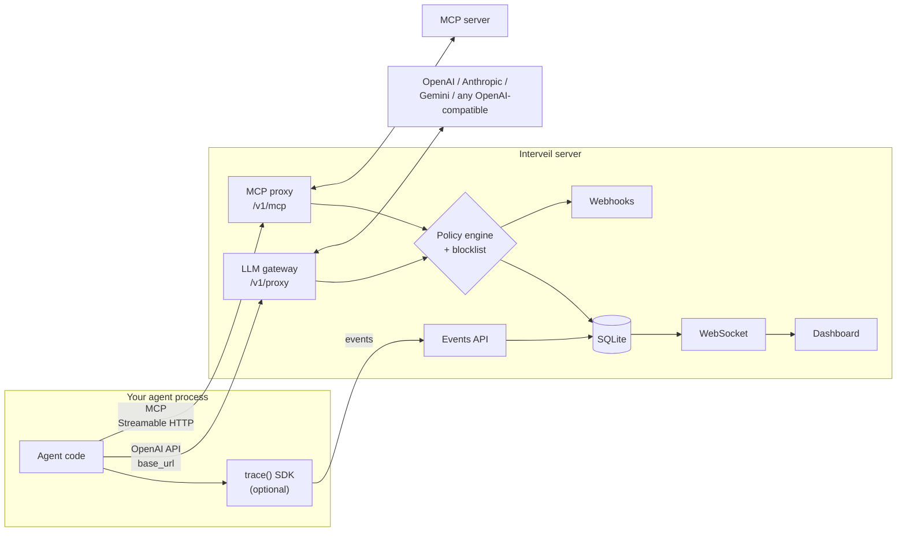

# Interveil

[](https://github.com/rpuranikx/Interveil/actions/workflows/ci.yml)

**A self-hosted gateway that traces AI agent runs and blocks disallowed tool calls before the agent can execute them, with policies in YAML.**


Point an agent's OpenAI `base_url` (or its MCP client) at Interveil. Every model call and tool call shows up live in a dashboard. Each tool call the model proposes is checked against your policy and a destructive-command blocklist, and disallowed calls are withheld before the agent ever receives them. Violations are recorded and can page you through a webhook.

> **Status: v0.1.** Install from source; not yet on npm or PyPI. Read [Limitations](#limitations) before relying on it.

## Quick start

Requires Node.js 22.12+ and pnpm (`corepack enable` installs the pinned version).

```bash
git clone https://github.com/rpuranikx/Interveil.git && cd Interveil
pnpm install
pnpm demo
```

`pnpm demo` needs no API keys. It opens the dashboard and runs a support agent that reaches a scripted model only through the gateway:

1. The agent looks up order #1042 and refunds $49. Both are allowed; the refund is recorded as `POLICY_AUDIT`.
2. The order notes contain a prompt injection. The model proposes a $4,900 refund to another account and a `curl … | bash`.
3. The gateway withholds both tool calls (one by the [YAML policy](interveil/examples/policies/support-agent.yaml), one by the blocklist), tells the agent why, and posts a webhook alert for each.

To run the server for your own agents: `pnpm build && node interveil/dist/cli.js serve`, or `docker compose up` (published on `127.0.0.1:3000`, data in the `interveil-data` volume, settings from `interveil/.env`; see [`.env.example`](interveil/.env.example)).

## How it works



Enforcement happens at four points, all driven by the same policy file and blocklist:

| Where | What is checked | Effect of a violation | Integration |
|---|---|---|---|
| **LLM gateway** | Every tool call in a model response, streaming or not | Tool calls withheld; the agent gets an explanation with `finish_reason: "stop"` | Change `base_url` |
| **MCP proxy** | Every `tools/call` request | Never forwarded; the client gets an `isError` tool result | Change the MCP server URL |
| **`trace()` SDK** | Every method call on the wrapped object | `PolicyViolationError` thrown before the method runs | Wrap the agent object |
| **Policy API** | Any tool call an agent runs itself, via `POST /api/v1/policy/evaluate` | The caller denies it (e.g. a Claude Agent SDK or Claude Code `PreToolUse` hook) | Register a hook |

## Integrations

| Stack | How | Lines changed | Example |
|---|---|---|---|
| Any OpenAI-compatible client (Python, TS, IDE tools) | `base_url="http://localhost:3000/v1/proxy"` | 1 | below |
| OpenAI Agents SDK (Python) | Default client pointed at the gateway, Chat Completions API | 3 | [`examples/openai-agents`](interveil/examples/openai-agents) |
| MCP clients (official SDK, Streamable HTTP) | Server URL → `http://localhost:3000/v1/mcp` | 1 | [`examples/mcp`](interveil/examples/mcp) |
| Claude Agent SDK / Claude Code | `PreToolUse` hook that calls the policy API | 3 / settings.json | [`examples/claude-agent-sdk`](interveil/examples/claude-agent-sdk) |
| TypeScript agent objects | `trace(agent, { policyFile })` | 1–2 | [`examples/typescript`](interveil/examples/typescript) |
| Python agent objects | `trace(agent, agent_id=..., enforce_policy=True)` | 1–2 | [`examples/python`](interveil/examples/python) |
| Anything else | POST events to the HTTP API | — | [API](#api) |

The OpenAI Agents SDK and MCP examples are verified against the real SDKs (`openai-agents` 0.24, `@modelcontextprotocol/sdk` 1.32); the MCP one is also an automated test. `InterveillCallbackHandler` (LangChain.js) and `createTracedAnthropic` (Anthropic SDK) are exported for tracing only; they do not enforce.

```python
from openai import OpenAI

client = OpenAI(
    base_url="http://localhost:3000/v1/proxy",
    api_key="sk-...",                                    # forwarded to the provider, never stored
    default_headers={"x-interveil-agent-id": "support-agent"},  # which policy rules apply
)
```

---

## Policy as code

```yaml
version: "1.0"
defaultAction: allow            # or `block` for deny-by-default

agents:
  - id: billing-agent
    rules:
      - id: large-refunds
        action: block
        message: Refunds over $100 need a human
        condition:
          tool: refund
          args.0.amount: { greaterThan: 100 }   # first argument's `amount` field
      - id: audit-refunds
        action: allow_and_audit
        condition: { tool: refund }

  - id: "*"                     # applies to every agent, after its own rules
    rules:
      - id: no-drops
        action: halt_agent
        severity: critical
        condition: { tool: dropDatabase }

alerts:
  webhooks:
    - url: https://hooks.example.com/interveil
      secretEnv: INTERVEIL_WEBHOOK_SECRET   # optional: env var holding the HMAC secret
```

Load it with `interveil serve --policy-file policy.yaml` (gateway and MCP proxy) or `trace(agent, { policyFile })`.

- **Actions:**
  - `allow`.
  - `allow_and_audit`: runs, and records `POLICY_AUDIT`.
  - `block`: refused, and records `POLICY_VIOLATION`.
  - `require_approval`: refused; there is no approval workflow yet.
  - `halt_agent`: refused, and every later request from that agent is refused too.
- **Conditions:** `tool` matches the tool or method name (or any name in a list). Any other key is a dot path into `{ args: [arguments] }` (the same shape in the gateway, MCP proxy and SDK), matched by an exact value or by constraints: `equals`, `notEquals`, `greaterThan`, `lessThan`, `contains`, `matches` (a regular expression) and `oneOf`. All keys and constraints must match; a value of the wrong type never matches. Example: `{ tool: [Write, Edit], args.0.file_path: { matches: '(^|[/\\])\.env$' } }`.
- **Order:** the agent's own rules, then `*` rules, then `defaultAction`. First match wins.
- **Fails closed:** a missing file, invalid YAML, an unknown action or a misspelled key throws `PolicyLoadError`. `serve` exits; `trace()` refuses to wrap the agent.
- **Environments:** `environments.<staging|production>.haltOnCritical: true` escalates `block` rules with `severity: critical` to `halt_agent`.

### Webhook alerts

The server posts `{"type": "policy.violation", "agent_id", "tool", "rule_id", "source", "message", "halt", "enforced_at", "session_id", "timestamp"}` for every violation it records, from the gateway, the MCP proxy or an SDK. Add `events: [POLICY_VIOLATION, POLICY_AUDIT]` to a hook to receive audits too. Delivery runs in the background (5 s timeout, one retry). With a secret set, verify the signature:

```typescript
const expected = 'sha256=' + createHmac('sha256', secret).update(`${req.headers['x-interveil-timestamp']}.${rawBody}`).digest('hex');
const valid = timingSafeEqual(Buffer.from(expected), Buffer.from(req.headers['x-interveil-signature']));
```

### Command blocklist

Applied everywhere a policy is, with no configuration. Every argument (nested objects, arrays and keys included) is lowercased, stripped of quotes and backslashes, whitespace-collapsed and split on `;`, `&&`, `||`, `$(` and backticks. Each piece is checked against named rules:
- recursive `rm`, `sudo rm`, `find -delete`, `shutil.rmtree`
- `curl|wget … | sh`, `base64 -d … | sh`
- `DROP TABLE/DATABASE`, `TRUNCATE`
- `mkfs`, `dd of=/dev/…`, `format c:`, `chmod 777 /…`
- `/etc/passwd|shadow|sudoers`, `~/.ssh/`, `~/.aws/credentials`

The TypeScript and Python implementations share a [test corpus](interveil/test-fixtures/blocklist-cases.json) of 34 inputs that must be blocked and 15 that must not. This is a speed bump for obviously destructive commands, not a sandbox: a determined agent can obfuscate a command past any pattern list.

---

## LLM gateway

`POST /v1/proxy/chat/completions` (OpenAI Chat Completions format). Requests and responses are recorded as `LLM_REQUEST` / `LLM_RESPONSE`, with tokens and latency.

**Sessions and agents:** `x-interveil-session-id` groups requests into a session; without it, requests are grouped into one session per day. `x-interveil-agent-id` selects the policy rules (default `default`).

**Tool-call enforcement:**
- If any tool call in a response is disallowed, all of that response's tool calls are withheld. The client gets `finish_reason: "stop"` and a message naming each rule.
- When streaming, text deltas still arrive live; tool-call chunks are held until the stream ends, then released byte-for-byte or replaced.
- `LLM_RESPONSE` keeps what the model originally proposed, next to the `POLICY_VIOLATION` events.

**Provider keys:** a client's own `Authorization: Bearer <provider key>` is forwarded and never stored. If the client sends no key, or sends the Interveil API key, the server uses `OPENAI_API_KEY` / `ANTHROPIC_API_KEY` / `GEMINI_API_KEY`.

**Other APIs:** `OPENAI_BASE_URL` points the gateway at any OpenAI-compatible API (Azure OpenAI, OpenRouter, Ollama).

| Provider (by model prefix) | Non-streaming | Streaming |
|---|---|---|
| OpenAI (`gpt-`, `o1`, `o3`, other) | Passed through | Passed through |
| Anthropic (`claude-`) | Translated to/from the Messages API | Anthropic events translated to OpenAI chunks |
| Gemini (`gemini-`) | Translated to/from `generateContent` | Gemini SSE translated to OpenAI chunks |

Tool calls are enforced for every provider, streaming or not. Translation covers system prompts, tools and `tool_choice`, assistant tool calls, tool results (merged into one message where the provider requires it), image inputs (Anthropic), `stop`, `top_p`, and token usage. The Gemini key is sent in the `x-goog-api-key` header, never in the URL.

## MCP proxy

`interveil serve --mcp-server http://localhost:8080/mcp` forwards `/v1/mcp` to one MCP server over Streamable HTTP:
- **Transport:** `Accept`, `Mcp-Session-Id` and `MCP-Protocol-Version` are forwarded, and SSE responses are passed through. The optional server-to-client `GET` stream returns 405.
- **Recording:** `tools/call` requests and results are recorded as `TOOL_CALL` / `TOOL_RESULT`.
- **Enforcement:** each call is checked before it is forwarded.

Stdio servers are not supported.

## SDKs

**TypeScript:** `npm install /path/to/Interveil/interveil` after `pnpm build`.

```typescript
import { trace } from 'interveil';

const agent = trace(new MyAgent(), { agentId: 'billing-agent', policyFile: './policy.yaml' });
await agent.refund({ amount: 500 });   // throws PolicyViolationError; refund() never runs
```

| Option | Default | Meaning |
|---|---|---|
| `host`, `port` | `localhost`, `3000` | Interveil server |
| `sessionName` | timestamp | Label in the dashboard |
| `agentId` | `'default'` | Agent id used by policy rules |
| `policyFile` | — | YAML policy; invalid files throw `PolicyLoadError` |
| `commandConfig` | — | `{ block, whitelist, requireApproval }` extra patterns |
| `dryRun` | `false` | Record calls without executing them |
| `autoOpen` | `true` | Open the dashboard on the first call |

**Python:** no dependencies; copy `interveil/python/interveil` into your project. `trace(agent, blocked_patterns=[...])` applies the blocklist locally. `trace(agent, agent_id="billing-agent", enforce_policy=True)` also asks the server's policy before each call (positional arguments, plus kwargs as a final dict, are evaluated as `args`) and raises `PolicyViolationError`; if the server can't answer, the call is refused.

**Policy API:** `POST /api/v1/policy/evaluate` with `{"tool", "agent_id", "arguments"}` (a tool-call arguments object) or `{"tool", "agent_id", "args"}` (positional arguments) returns `{"allowed", "audit", "halt", "rule_id", "source", "message"}`. Add `session_id` to record the decision in that session.

---

## Security model

**Protected:**
- The server binds to `127.0.0.1`. To expose it, set `INTERVEIL_API_KEY` and use `--host 0.0.0.0`.
- With a key set, `/api` (except health), `/v1` and `/ws` require it (`x-interveil-key` or `Authorization: Bearer`). The SDKs read the same variable; the dashboard asks for it.
- Requests and WebSocket handshakes from other browser origins are refused unless listed in `--allowed-origins`, so a web page cannot read your traces or spend your provider keys.
- Per-IP rate limits: 1000/min on `/api` and 120/min on `/v1`, configurable with `INTERVEIL_RATE_LIMIT_*`.

**Not protected:** see the first three [Limitations](#limitations).

## Performance

`pnpm bench` pairs each gateway request with a direct call to the same local fake provider and reports the difference. It measures the gateway's own overhead, not network or model time. On an i9-13900H, Node 24, Windows 11, 500–1,000 paired requests per run:

| Store | Added latency, p50 | p95 | Tool call + policy check, p50 | p95 |
|---|---|---|---|---|
| In-memory | 0.74–0.89 ms | 1.49–1.76 ms | 0.68–0.73 ms | 1.36–1.51 ms |
| SQLite (default) | 1.4–2.3 ms | 2.2–4.6 ms | 1.4–2.4 ms | 2.1–4.6 ms |

Figures are ranges across runs (two in-memory, four SQLite). Every concurrent-stream run completed all of its streams; with 100 at once, in 0.26–0.35 s.

## CLI and API

```bash
interveil serve                         # http://localhost:3000, SQLite at ~/.interveil/traces.db
interveil serve --db memory             # in-memory store
interveil serve --policy-file policy.yaml --mcp-server http://localhost:8080/mcp
interveil serve --host 0.0.0.0 --allowed-origins https://app.example.com
interveil run node my-agent.js          # start the server, run a command, keep serving
interveil demo [--step-delay 2500]      # the scripted prompt-injection demo
```

`interveil` is `node interveil/dist/cli.js` until the package is published. The CLI loads `./.env` if present.

| Method | Path | Description |
|---|---|---|
| `POST` | `/v1/proxy/chat/completions` | LLM gateway |
| `POST`, `DELETE` | `/v1/mcp` | MCP proxy |
| `POST` | `/api/v1/events` | Ingest a trace event (sessions are created on first event) |
| `POST` / `PATCH` | `/api/v1/sessions[/:id]` | Register a session / mark it `completed` or `failed` |
| `GET` | `/api/v1/sessions[/:id/events]` | List sessions / events for a session |
| `POST` | `/api/v1/policy/evaluate` | Ask the policy and blocklist whether a tool call may run |
| `GET` | `/api/v1/health` | Health check (no key required) |
| `WS` | `/ws` | Live event stream (`?token=<key>` when a key is set) |

## Limitations

- **Enforcement only covers traffic through Interveil.** An agent that calls a provider directly, spawns processes itself, or uses an unwrapped object is not stopped. Interveil does not sandbox the agent's process.
- **The gateway decides on what the model proposed.** It cannot see what an agent does with an allowed tool call.
- **Agent identity is asserted by the client** (`x-interveil-agent-id`). Use separate deployments or keys when agents must not impersonate each other.
- **Halts are in memory** and clear when the server restarts.
- Provider translation covers chat, tools and images (Anthropic); provider-specific features without an OpenAI equivalent (Anthropic prompt caching and extended thinking, Gemini safety settings) are not passed through.
- `require_approval` blocks; there is no approval workflow.
- One process and one SQLite file. No multi-user accounts, retention or redaction; prompts are stored in plain text.

## Development

```bash
pnpm test                                  # vitest: 127 tests
pnpm --filter interveil run test:coverage
pnpm lint && pnpm typecheck
cd interveil && python -m unittest discover -s python/tests   # 7 tests
pnpm bench
```

CI runs all of the above (except `bench`), a demo smoke test, and a Docker build with a health check.

**Repository layout:**
- `interveil/`: server, SDKs, dashboard and examples.
- `interveil-vscode/`: a VS Code extension that embeds the dashboard.
- `index.html`: the project site.
- `AUDIT.md`: the review this version was built from.

**Author:** Rishi Puranik, Solutions Engineer & AI Infrastructure Builder · **License:** [MIT](LICENSE)
